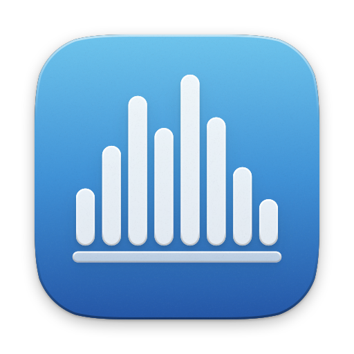

# Spectrum

Spectrum shows the spectrogram of an audio file: drop a file on the window, and you see which frequencies it holds over time and how loud they are. It is the classic way to tell a real lossless file from an upscaled MP3 (the cut-off around 16–20 kHz), to spot clipping, hum or noise.

Spectrum is a native macOS version of [Spek](https://github.com/alexkay/spek) by Alexander Kojevnikov and contributors. It works the same way, with the same layout, keys and analysis; the window, icons and colours follow macOS and the rest of the suite, and it is much faster to start and to analyse a file.

## How it works

- **Open a file**: drop it on the window or the Dock icon, ⌘O, *Open With › Spectrum* in Finder, or `Spectrum FILE`. One file at a time, as Spek.
- **The window** is laid out as in Spek: the file path and its properties at the top (stream, codec, bitrate or bit depth, sample rate, channel, FFT window size and function), the spectrogram in the middle with the time ruler below and the frequency ruler on the left, the palette with the dB ruler on the right.
- **Save** (⌘S) writes the window as a PNG, named after the file.
- **Keys**, as in Spek (lowercase forward, uppercase back); they are also in the **Spectrogram** menu:

| Key | |
| --- | --- |
| `c` `C` | audio channel |
| `s` `S` | audio stream |
| `f` `F` | DFT window function (Hann, Hamming, Blackman–Harris) |
| `w` `W` | DFT window size (256 to 16384) |
| `l` `L` | lower limit of the dynamic range, dBFS |
| `u` `U` | upper limit of the dynamic range, dBFS |
| `p` `P` | palette (Spectrum, SoX, Mono) |

- **Settings** (⌘,) holds the same values with pickers and steppers, and they are remembered between launches. Spek's language setting and update check are gone: macOS sets the language and Spectrum never goes online.
- **Help** (F1) lists the keys; **About** (⇧F1) credits Spek's authors.

## What changed from Spek

| | Spek 0.8.5 | Spectrum |
| --- | --- | --- |
| App | wxWidgets, Intel only (runs under Rosetta on Apple Silicon), 71 bundled libraries, 89 MB | native SwiftUI + AppKit, Apple Silicon, 21 MB |
| Window | wxWidgets toolbar and dialogs | macOS window with unified toolbar, proxy icon, light and dark mode |
| Spectrogram | drawn on black with white text | same layout, system fonts, rounded frame, follows the appearance; equal margins on both sides (Spek: 60 pt left, 90 pt right); one column per pixel on Retina screens (Spek: per point) |
| Analysis | one decoder, the whole file decoded again at every change | see below |

**Faster.** Measured on this Mac from `open` to the window on screen: Spek 3.7 s after a while unused (18 s the very first time, while Rosetta translated it), 0.45 s right after quitting; Spectrum 0.55 s and 0.28 s. A 5-minute MP3 or FLAC is analysed in about 0.15 s:

- the file is decoded by several `ffmpeg` processes at once, one slice of the duration each (one per performance core), and columns appear as soon as their samples are in;
- the FFTs use Accelerate (vDSP) on every core;
- the decoded samples stay in memory: changing the window size or function, the channel or the window width recomputes from memory without decoding the file again (Spek decodes it again for every key press and every resize); the palette and the dynamic range only repaint;
- the bundled FFmpeg is a minimal build with only what reading audio needs (10 MB instead of 66 MB), quicker to start;
- files longer than about 24 minutes are analysed a stretch at a time (about 6 minutes each), so memory stays small: a 3-hour MP3 takes 7 s and about 220 MB.

Slices are checked against a one-piece decode (`SPECTRUM_SLICES=1`) on MP3 (CBR, VBR, without Xing header), AAC, M4A, Ogg Vorbis, Opus, FLAC and WMA: the pictures match. WMA, whose seeking isn't sample-exact, is always decoded in one piece.

The analysis itself is Spek's: the duration is split into as many intervals as the spectrogram has columns; each column is the average, in dB, of the FFTs that end every *window size* samples inside its interval (one FFT at its end when the interval is shorter), with Spek's window functions and palettes.

## Tools inside the app

`Contents/Resources/bin` holds `ffmpeg` and `ffprobe` from FFmpeg 7.1.2, built by `scripts/fetch-tools.sh` from the source at https://ffmpeg.org/releases/ffmpeg-7.1.2.tar.xz (checked against its SHA-256) with only the demuxers, parsers and audio decoders: every format Spek reads (MP3, AAC, ALAC, FLAC, WAV, AIFF, Ogg Vorbis, Opus, WMA, APE, WavPack, Musepack, AC-3, DTS, and the audio of video files). Built without GPL parts or external libraries, so the binaries are LGPL 2.1.

## Building

```
scripts/setup-signing.sh   # once: local signing identity in signing/
scripts/build-app.sh       # builds the decoder if needed, builds, signs, installs in /Applications
scripts/make-dmg.sh        # installer: build/Spectrum-<version>.dmg
```

Apple Silicon, macOS 15 or later. `scripts/make-icon.swift` draws the icon.

Test modes:

```
SPECTRUM_TOOLS=vendor/bin .build/release/Spectrum --render FILE OUT.png [WIDTH HEIGHT]   # no window; prints the timings
SPECTRUM_TRACE=1 …                                                                        # also when each step ends
open --env SPECTRUM_SNAPSHOT=<dir> --env SPECTRUM_OPEN=FILE build/Spectrum.app            # PNG of each window every second
```

## License

GPL v3, as Spek (see `LICENSE`). Spek © 2010–2023 Alexander Kojevnikov and contributors; this version rewrites it in Swift with a new interface and decoding pipeline. FFmpeg is LGPL 2.1.
